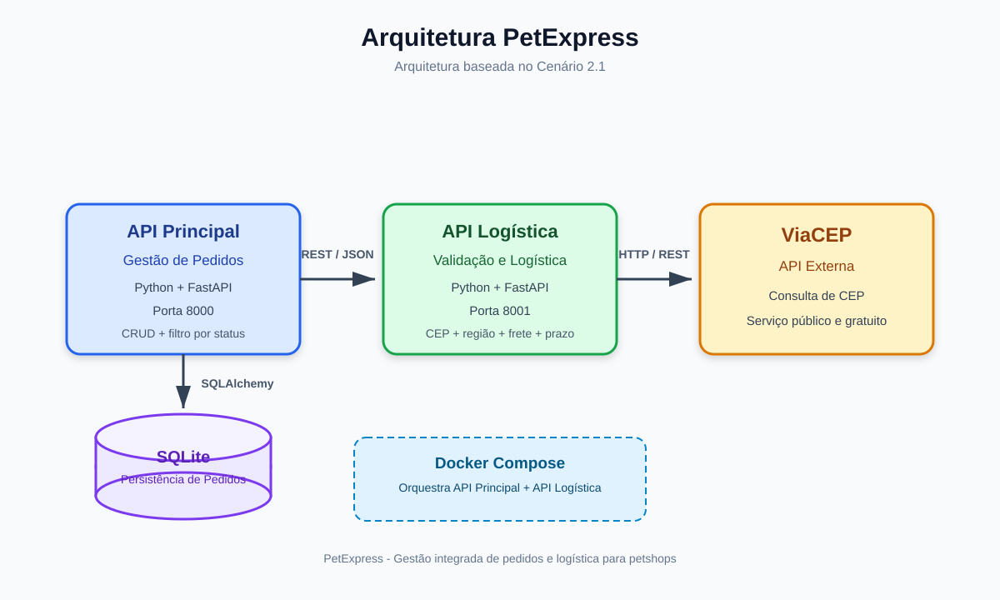

# PetExpress - API Principal

API Principal do sistema PetExpress, uma solução para gerenciamento e logística de entregas de petshops.

O PetExpress centraliza o ciclo de vida dos pedidos e utiliza uma arquitetura baseada em serviços para validar endereços, verificar regiões atendidas e calcular estimativas de frete e prazo de entrega.

## Objetivo

O sistema foi desenvolvido para resolver o problema de gestão e logística de entregas de petshops.

Ao cadastrar um pedido, a API Principal consulta automaticamente a API de Logística. A API de Logística utiliza o serviço externo ViaCEP para validar o CEP e obter informações do endereço, além de aplicar as regras de região atendida, frete e prazo.

Somente após esse processamento o pedido é persistido pela API Principal.

## Arquitetura

A aplicação segue uma arquitetura baseada no Cenário 2.1 proposto para o MVP.

O fluxo principal é:

```text
Cliente / Swagger
       |
       | REST / JSON
       v
API Principal
Gestão de Pedidos
FastAPI - Porta 8000
       |
       | REST / JSON
       v
API de Logística
Validação + Frete
FastAPI - Porta 8001
       |
       | HTTP / REST
       v
ViaCEP
API Externa
```

A API Principal também utiliza SQLite para persistência dos pedidos.

### Fluxograma da arquitetura



## Componentes

### API Principal

Responsável pela gestão dos pedidos e pela persistência dos dados.

Principais responsabilidades:

- Criar pedidos.
- Consultar pedidos.
- Filtrar pedidos por status.
- Atualizar pedidos.
- Excluir pedidos.
- Solicitar validação geográfica e cálculo logístico à API de Logística.
- Persistir os pedidos em SQLite.

### API de Logística

Componente independente responsável pelas regras relacionadas à logística.

Principais responsabilidades:

- Validar CEP.
- Consultar endereço.
- Verificar região atendida.
- Calcular valor de frete.
- Calcular prazo de entrega.
- Consumir e tratar os dados fornecidos pelo ViaCEP.

### ViaCEP

Serviço externo utilizado pela API de Logística para consultar informações de endereço a partir do CEP.

## Tecnologias utilizadas

- Python 3.13
- FastAPI
- SQLAlchemy
- SQLite
- Pydantic
- Requests
- Uvicorn
- Docker
- Docker Compose

## Persistência

A API Principal utiliza SQLite.

Os pedidos são armazenados na tabela:

```text
pedidos
```

Entre os dados persistidos estão:

- identificador;
- cliente;
- CEP;
- logradouro;
- número;
- complemento;
- bairro;
- cidade;
- UF;
- descrição do pedido;
- status;
- valor do frete;
- prazo de entrega;
- data de criação.

## Rotas da API Principal

### GET /health

Verifica se a API Principal está funcionando.

### GET /pedidos

Lista os pedidos cadastrados.

Também permite filtrar os pedidos pelo status.

Exemplo:

```text
GET /pedidos?status_pedido=pendente
```

O filtro por status representa uma funcionalidade adicional ao CRUD básico.

### POST /pedidos

Cria um novo pedido.

Exemplo do corpo:

```json
{
  "nome_cliente": "João Souza",
  "cep": "01001000",
  "numero": "300",
  "complemento": "Sala 3",
  "descricao_pedido": "Ração premium"
}
```

Durante a criação, a API Principal consulta a API de Logística antes de persistir os dados.

O fluxo é:

```text
POST /pedidos
      |
      v
API Principal
      |
      v
POST /frete
      |
      v
API de Logística
      |
      v
ViaCEP
      |
      v
Tratamento dos dados e regra logística
      |
      v
API Principal
      |
      v
SQLite
```

### PATCH /pedidos/{pedido_id}

Atualiza parcialmente um pedido.

Exemplo:

```json
{
  "status": "em_entrega"
}
```

### DELETE /pedidos/{pedido_id}

Exclui um pedido.

